

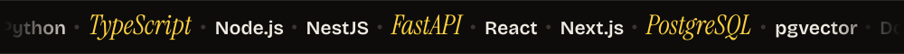


<table>
  <tr>
    <td><a href="https://github.com/ByteNinjaSmit/Agentx"></a></td>
    <td><a href="https://github.com/ByteNinjaSmit/aptino-claim-engine"></a></td>
  </tr>
  <tr>
    <td><a href="https://github.com/ByteNinjaSmit/digital-twin-cyber-attack-iiot"></a></td>
    <td><a href="https://github.com/ByteNinjaSmit/Self-balancing-bicycle"></a></td>
  </tr>
  <tr>
    <td><a href="https://github.com/ByteNinjaSmit/NovaGhost"></a></td>
    <td><a href="https://github.com/ByteNinjaSmit/blood-bank"></a></td>
  </tr>
</table>

Also on the shelf &nbsp;·&nbsp;
<a href="https://github.com/ByteNinjaSmit/kaamsathi-voice-guide">KaamSathi voice guide</a> &nbsp;·&nbsp;
<a href="https://github.com/ByteNinjaSmit/LipNet">LipNet</a> &nbsp;·&nbsp;
<a href="https://github.com/ByteNinjaSmit/Fake-Job-Post-Prediction">Fake-job detector</a> &nbsp;·&nbsp;
<a href="https://github.com/ByteNinjaSmit/path-hole">PathHole</a> &nbsp;·&nbsp;
<a href="https://github.com/ByteNinjaSmit/USV">USV</a> &nbsp;·&nbsp;
<a href="https://github.com/ByteNinjaSmit/KrishiMitraAI">KrishiMitraAI</a> &nbsp;·&nbsp;
<a href="https://github.com/ByteNinjaSmit/mental_health_ai">Mental-health AI</a> &nbsp;·&nbsp;
<a href="https://github.com/ByteNinjaSmit/smart-irrigation-system">Smart irrigation</a>






pick a year ↓

<b>2026</b> &nbsp;·&nbsp; 1,522 contributions

<b>2025</b> &nbsp;·&nbsp; 1,053 contributions

<b>2024</b> &nbsp;·&nbsp; 255 contributions

<b>2023</b> &nbsp;·&nbsp; 5 contributions


&nbsp;
<a href="https://www.linkedin.com/in/smitrajbankar">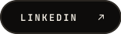</a>
&nbsp;
<a href="https://leetcode.com/u/smitrajbankar">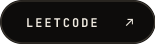</a>

